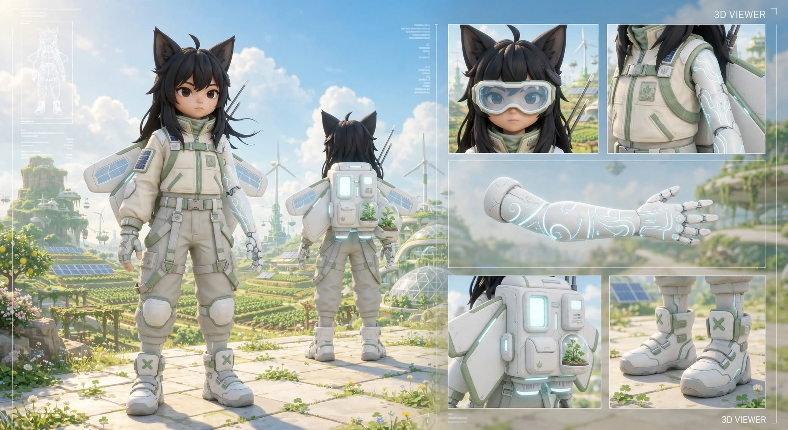
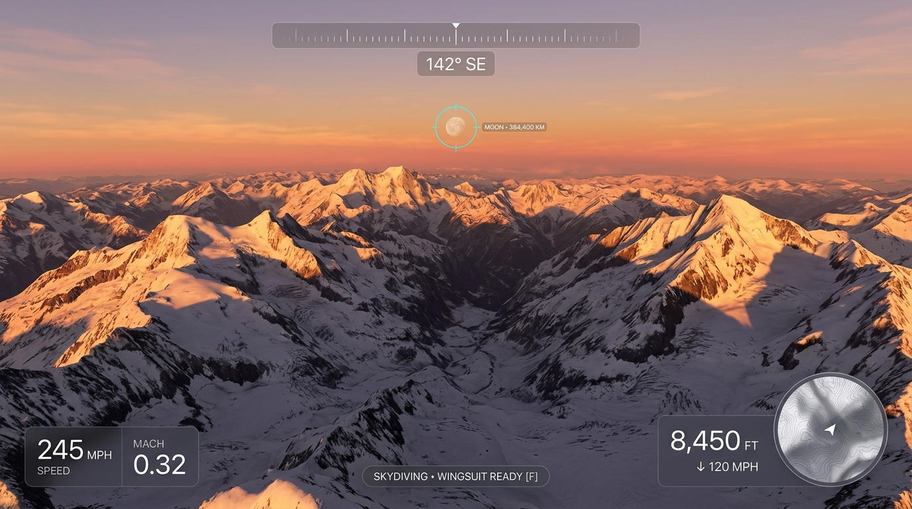
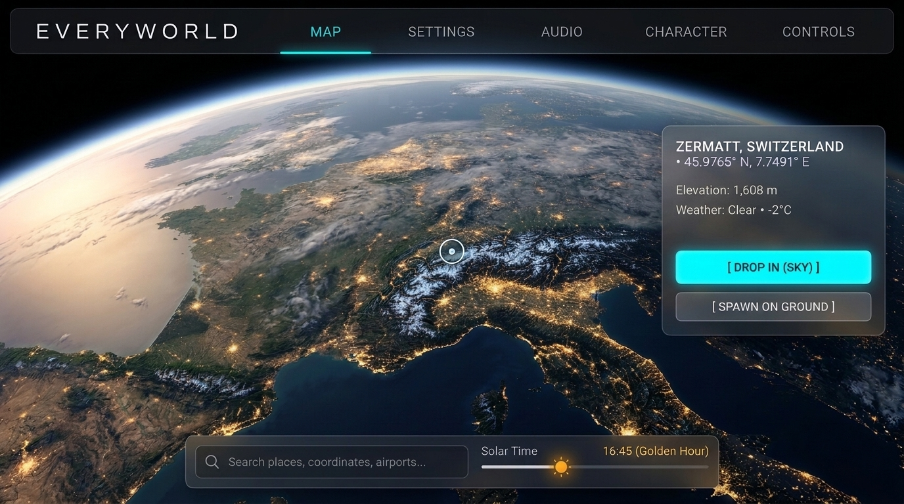
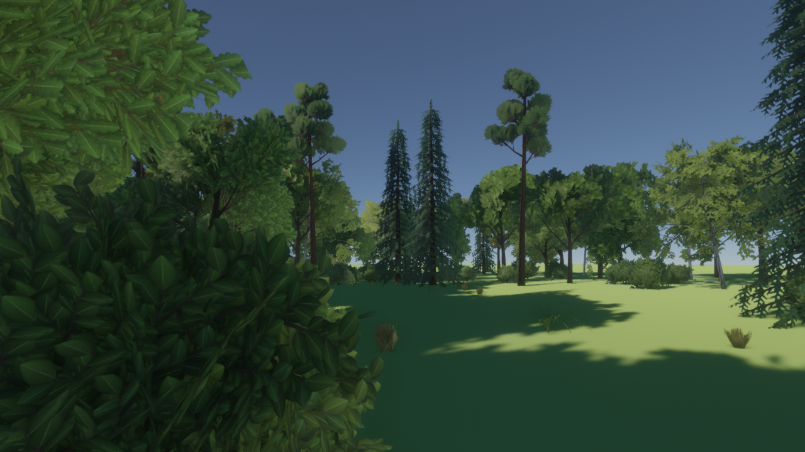
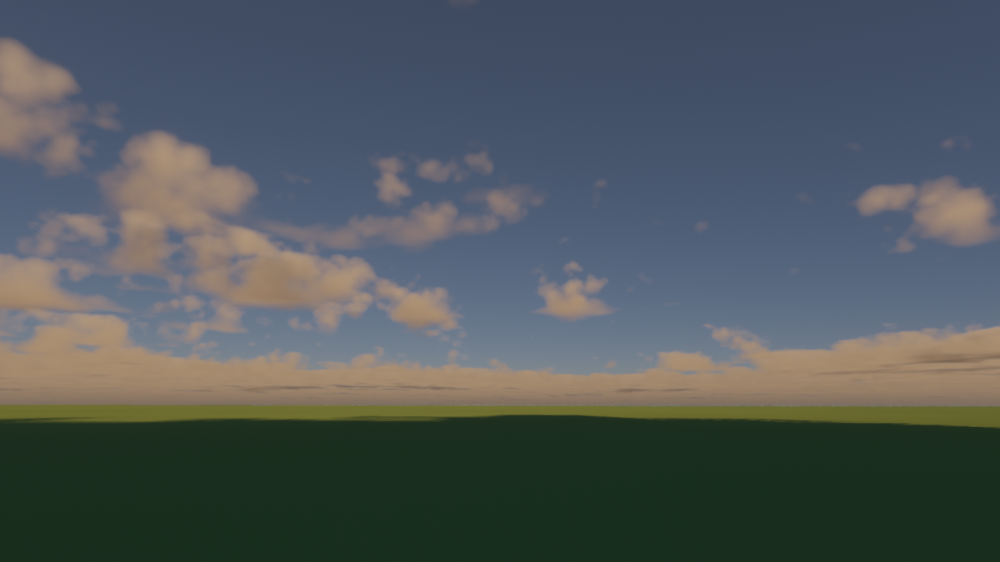
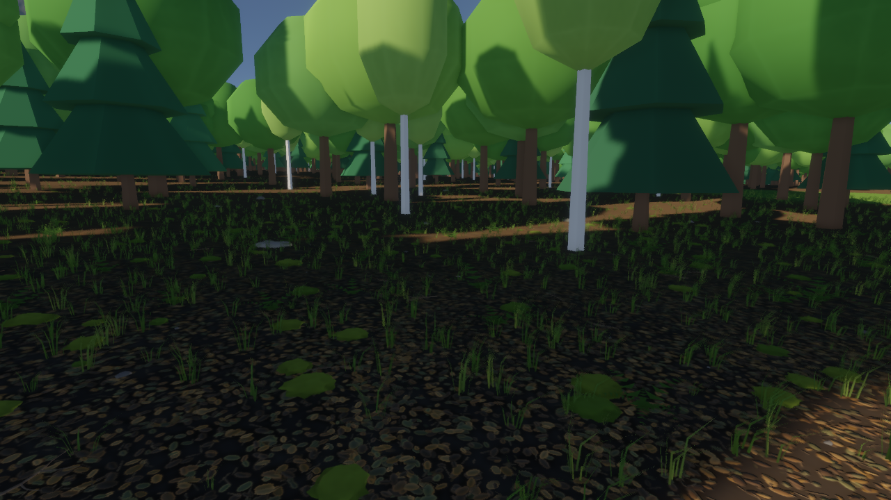

# EveryWorld — overview and document map

Working title; the final name is undecided. This page is the short version of the whole
project and tells you which document owns each subject. It does not restate their content in
detail; where two documents seem to disagree, the owner listed below wins.

> **Status:** custom-engine rebuild. Phase 0 (Prepare) complete; **Phase 1 (Engine base and editor shell)** next.
> **Branches:** `main` = new engine and these docs. `alpha-early` = frozen Bevy alpha.

## 1. Document map

| Subject | Owner document |
|---|---|
| What the game is, in the owner's words | `VISION.md` |
| Locked decisions (D, F, P1-D ids) | `DECISIONS.md` |
| Target design | `ARCHITECTURE.md` |
| Order of work and gates | `ROADMAP.md` |
| Current phase, in detail | `phases/phase-1.md` (Phase 0 exit record: `phases/phase-0.md` §5) |
| Next phase, in detail | `phases/phase-1.md` |
| Addressing, far-field ladder, streaming, authored layers | `plans/world.md` |
| GPU interface, renderer, cluster-geometry track | `plans/renderer.md` |
| Street data and road generation | `plans/streets.md` |
| Editor | `plans/editor.md` |
| Water | `plans/water.md` |
| Milestones from here to the playable solo loop | `plans/path-to-solo.md` |
| Gameplay: core loop, missions, trust | `plans/solastra-core-loop.md` |
| What the alpha was, what carries over | `plans/rearchitecture.md` |
| Data sources, licensing, acquisition | `data/README.md`, `data/registry.md` |
| Art and asset specifications | `solarpunk/spec.md`, `solarpunk/character-spec.md`, `ui/` |
| Goal status board | `GOALS.md` |
| Change log | `CHANGES.md` |
| Alpha archive | `alpha/` |
| Interface contracts | `contracts/` |
| Phase 0 spike results | `reference/spikes/`, `reference/determinism.md` |
| Alpha baseline and budgets | `reference/alpha-baseline.md` |

## 2. The game

A persistent, shared, solarpunk twin of the real Earth, with the Moon and Mars. Walk, drive,
fly and launch to orbit with no loading screens. Progress by rank, trust and merit, not
money. Build a home. The north-star session: drive out of a forest into a city, pick up a
friend, do a mission, launch from a spaceport, land on the Moon, come back to the car you
parked, drive home (`VISION.md` §2).

## 3. The engine

A custom Rust engine (D1) with an editor (D15):

- **One planet, one address.** A cube-sphere quadtree; every system keys on `NodeId` (F1).
- **Far field by design.** Each node can be shown as parts, building shells, a merged proxy,
  terrain-baked features, or imagery and night lights, so cities are visible from far away
  and Earth is visible from the Moon (F2, D16).
- **Fast, complete loading.** Chunks come from a shipped globe pack, our tile service, or
  local generation, coarse first; a parent draws until its children are ready (F4).
- **GPU-driven rendering** of instanced parts with LOD, through a geometry slot that also
  accepts cluster ("Nanite-style") geometry developed in parallel (F3, D17).
- **Authoring.** Stable object ids and text override layers let the editor place buildings,
  markers and missions on a generated world (F5, F6).
- **Streets** from Overture and OSM tags, solved into lanes, junctions, heights, a nav graph
  and parcels (F8).
- **Simulation** at a fixed step on Box3D; region servers; QUIC networking; one persistence
  schema for solo and shared play.

## 4. Why a rebuild

The alpha proved the idea and showed the limits of its structure: the Metal renderer looks
good but runs poorly, loads slowly and has gaps, because geometry is merged per tile,
generated at full detail on the player's machine, mirrored from a second engine, and
addressed differently by each layer. The causes and what carries over are in
`plans/rearchitecture.md`.

## 5. Phases

| # | Phase | One-line gate |
|---|---|---|
| 0 | Prepare | Baselines, spikes, contracts; no open foundation question |
| 1 | Engine base + editor shell | 100k instances at 60 fps; second backend; pick-move-save in the editor |
| 2 | Planet, far field, streaming | Unbroken street → orbit → Moon view → back; city lights from orbit |
| 3 | World content on the ladder | Fly into reference cities with no pops; drive with no road gaps; placed landmark visible from 50 km |
| 4 | Rendering quality | Matches or beats the alpha look captures at budget |
| 5 | Simulation and vehicles | Car feel sign-off; parked car persists |
| 6 | Golden path, solo | The north-star loop in one recording |
| 7 | Multiplayer and persistence | Shared car and mission; launch seen across regions |
| 8 | Living world | Populated world on the first server |
| 9 | Platforms and ship | macOS and Windows shipped; mobile tier proven |
| G | Cluster geometry (parallel) | Adopted where it beats discrete LOD |

Full table: `ROADMAP.md`.

## 6. Art direction and reference imagery

Three layers (D5):

1. **Photoreal nature:** scanned materials, physical atmosphere, real global illumination
   and reflections, dense foliage.
2. **Expressive characters:** cartoon-proportioned heroes; players choose toon or realistic
   shading per avatar; NPCs are realistic. All are lit by the same sun and GI.
3. **Solarpunk civilization:** modular architecture in five regional families on a 2 m grid
   (`solarpunk/spec.md`), stylised by design and rendered with physical materials.

Character reference (`solarpunk/character-spec.md`):

UI direction (`ui/`):

Alpha lookdev, the baseline to beat (`lookdev/round2/`):

| Trees | Clouds | Ground |
|---|---|---|
|  |  |  |

The alpha's measured performance is in `reference/alpha-baseline.md`; its look-reference
captures go in `reference/look/` (still to be taken).

## 7. Risks

| Risk | Handling |
|---|---|
| Scope | Gates; every phase ends runnable; solo loop before multiplayer |
| Custom renderer cost | Discrete-LOD base first; cluster geometry and advanced lighting are additive (F3, F9) |
| Young dependencies (Box3D, Solstice) | Tested in Phase 0; behind our interfaces; reference only for Solstice (F10, F12) |
| RHI shaped by Metal alone | Minimal second backend in Phase 1 (F7) |
| 18 GB development machine | High tier sized to it; baseline lighting path always available (F9) |
| Licensing | Registry and gate in CI; ODbL position reviewed; RED never ships (F13) |
| Globe pack size, tile service cost | Measured in Phase 0; levels and resolution adjustable (F4) |
| "All code" look | Authored kit, prefabs and hubs placed through the editor; rules only lay out the ordinary |

## 8. External references

- Box3D: https://github.com/erincatto/box3d (MIT)
- meshoptimizer: https://github.com/zeux/meshoptimizer (MIT)
- Solstice (reference only): https://github.com/SamG-Coder/solstice (MIT)
- Overture Maps: https://docs.overturemaps.org/
- Slang: https://shader-slang.org/
- Megascans licence: https://www.fab.com/eula
- MotionBricks (optional, later): https://nvlabs.github.io/motionbricks/
