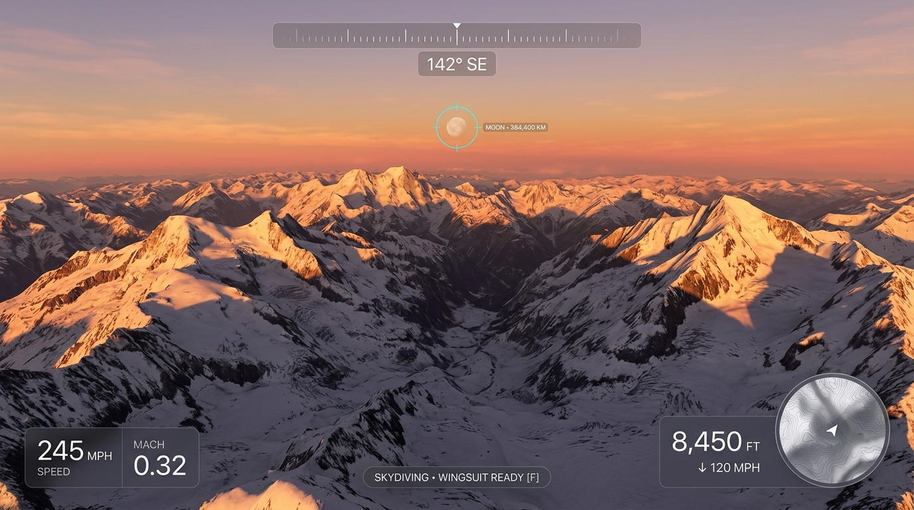
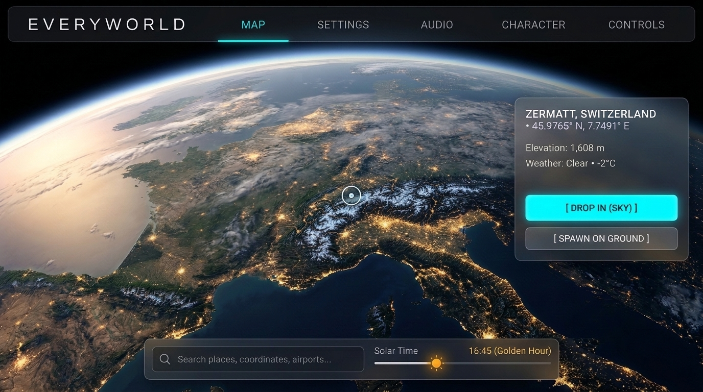

# EveryWorld — UI & HUD Design System & Guide

This document defines the **Modern Aero-Glass** interface design system for *EveryWorld*, including design tokens, information architecture, visual references, and implementation details for both the in-game HUD and the menus.

---

## 1. Visual References

The design system is grounded in modern aerospace avionics (e.g. Dreamliner/A350 glass cockpits), minimalist glassmorphism (visionOS), and precision exploration instruments.

| In-Game Flight & Skydive HUD | Main Menu & World Navigation Screen |
|---|---|
|  |  |

- **HUD Mockup:** `docs/ui/everyworld_hud_concept.jpg`
- **Menu/Map Mockup:** `docs/ui/everyworld_menu_concept.jpg`

---

## 2. Design Tokens

All UI components across both HUD and menus share the following color tokens and styling rules:

### Colors

```rust
// Backgrounds & Glass Overlays
pub const GLASS_BG: Color = Color::srgba(0.04, 0.06, 0.09, 0.72);
pub const GLASS_BG_DEEP: Color = Color::srgba(0.03, 0.04, 0.07, 0.85);

// Hairline Borders
pub const GLASS_BORDER: Color = Color::srgba(1.0, 1.0, 1.0, 0.14);
pub const GLASS_BORDER_SUBTLE: Color = Color::srgba(1.0, 1.0, 1.0, 0.08);

// Accents
pub const ACCENT_CYAN: Color = Color::srgb(0.35, 0.82, 0.98);   // Flight targets, headings, climb
pub const ACCENT_AMBER: Color = Color::srgb(0.98, 0.65, 0.15);  // Warnings, supersonic, descent
pub const ACCENT_ORANGE: Color = Color::srgb(0.98, 0.45, 0.12); // Primary actions / player dot

// Typography & Text
pub const TEXT_PRIMARY: Color = Color::WHITE;
pub const TEXT_SECONDARY: Color = Color::srgba(1.0, 1.0, 1.0, 0.82);
pub const TEXT_MUTED: Color = Color::srgba(1.0, 1.0, 1.0, 0.48);
```

### Geometry & Borders
- **Corner Radii:** Cards: `12.0 px` to `14.0 px`; Pills/Badges: `18.0 px` to `20.0 px`; Circular instruments (Minimap, celestial reticles): `BorderRadius::MAX`.
- **Borders:** Thin `1.0 px` to `1.5 px` hairline borders with subtle alpha (`0.10` - `0.20`), creating an authentic glass edge without visual weight.

---

## 3. In-Game HUD Architecture (`crates/ed_game/src/hud.rs`)

### Spatial Hierarchy

The screen is organized by natural pilot sightlines:

```
                      ┌─────────────────────────────────┐
                      │  ··· N ··· NE ··· E  │  045° NE │   (Top-Center: Heading Tape & Badge)
                      └─────────────────────────────────┘

(Top-Left: Debug Stats when toggled)                                  (Distant: Celestial Targets ⊕)


                      ┌─────────────────────────────────┐
                      │  SKYDIVING  •  WINGSUIT ON [F]  │   (Bottom-Center: Contextual Action)
                      └─────────────────────────────────┘
┌──────────────────┐                                                ┌──────────────────┐
│ AIRSPEED         │                                                │ ALTITUDE (MSL)   │
│ 245 MPH          │                                                │ 8,450 FT         │
│ MACH 0.32        │                                                │ ↓120 mph • AGL 4k│
└──────────────────┘                                                └──────────────────┘
(Bottom-Left)                                                       ┌──────────────────┐
                                                                    │   ( ◉ ) Minimap  │
                                                                    └──────────────────┘
                                                                    (Bottom-Right)
```

1. **Top Center — Compass Tape & Digital Heading**:
   - Replaced legacy high-contrast white paper box with frosted dark glass.
   - Divided into a subtle 70° window tick tape (`· · · N · · · NE`) and a crisp cyan numeric readout (`045° NE`).
2. **Bottom Left — Speed & Aerodynamics Cluster**:
   - Small muted category title: `AIRSPEED`.
   - Large primary readout: `245` `MPH` in bold 26px tabular figures.
   - Secondary telemetry: `MACH 0.32` (or ground speed / vertical rate). Transonic (`>0.8`) and Supersonic (`>1.0`) triggers distinct accent highlights.
3. **Bottom Right — Altitude & Ground Clearance Cluster**:
   - Stacked directly above the minimap for unified vertical + horizontal navigation.
   - Primary readout: `ALTITUDE (MSL)` with `8,450` `FT`.
   - Sub-readout: Displays vertical rate (`↓ 120 MPH` or `↑ 45 MPH`) and `AGL` (Above Ground Level), e.g. `AGL 4,200 FT` for terrain clearance.
4. **Bottom Center — Mode & Contextual Controls**:
   - Slim horizontal pill.
   - Dynamically formats according to active mode:
     - `SKYDIVING • WINGSUIT READY [F]`
     - `ROCKET SHOES • BOOST III [SPACE]`
     - `PARACHUTE • ACTIVE`
     - `WALKING • SPRINT [SHIFT]`
5. **Minimap (`crates/ed_game/src/minimap.rs`)**:
   - Circular radar form-factor (`BorderRadius::MAX`).
   - Hairline glass border and dark translucent backing so vector terrain layers composite naturally.
6. **Celestial Targets**:
   - Delicate 24px hairline circle reticles with cyan tint (`ACCENT_CYAN`).
   - Clean tabular uppercase label (`MOON • 384,400 KM`).

---

## 4. Menu & World Navigation Roadmap (`crates/ed_game/src/menu.rs`)

### Planned Overhaul
1. **Typography Migration**:
   - Remove `Chewy-Regular.ttf` comic font.
   - Introduce modern, clean geometric typography with wide tracking for titles and crisp tabular numbers for coordinates and settings.
2. **Top Navigation Bar**:
   - Slim frosted-glass bar spanning the top with low-profile button tabs (`MAP`, `SETTINGS`, `AUDIO`, `CHARACTER`, `CONTROLS`, `DEBUG`, `MULTIPLAYER`).
3. **Floating Destination Card**:
   - Replacing simple text labels with a glass floating card showing selected destination name, coordinates, altitude, live weather, and distinct sky vs. ground spawn actions.
4. **Solar Daylight Bar**:
   - Sleek horizontal slider with sun/moon icons for solar time scrubbing.
